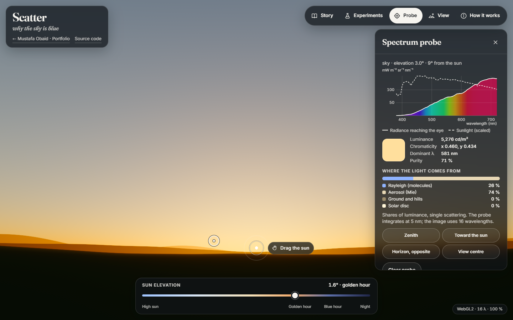

# Scatter — why the sky is blue

A spectral sky simulator: drag the sun, change the physics, and see why skies are blue, sunsets red
and Martian sunsets blue.

**Live demo:** https://mustafaobaidd1.github.io/scatter-sky-lab/



## The question

Why is the daytime sky blue rather than violet, why do sunsets turn red, and why are sunsets on
Mars blue? Scatter answers by computing the light itself: sunlight scattered by molecules and
particles, wavelength by wavelength, turned into colour the way the eye sees it. Every colour on
screen comes from the physics. Nothing is painted by hand.

## Features

- **A physically based sky you can drag.** The sun handle moves the sun anywhere (or use the arrow
  keys, or the sun-elevation scrubber). One drag from high sun to the horizon shows the whole story:
  blue overhead, orange and red near a setting sun, the blue hour after it.
- **Spectral rendering.** Rayleigh and Mie single scattering with ozone absorption at 16 wavelengths
  (380–720 nm), CIE 1931 colorimetry, exposure from a sky light meter and a filmic tone map. A
  limb-darkened solar disc reddens near the horizon. Use _View → Zoom on the sun_ to see it.
- **Camera.** Look around by dragging the sky (or W A S D), zoom with the wheel or a pinch, and rise
  from 2 m to 400 km. Above the atmosphere it becomes a thin glowing shell at the planet's limb.
- **Spectrum probe.** Tap any point (or press P and pick a preset) to see the spectral radiance
  reaching the eye, next to the solar spectrum. You also get the perceived colour, luminance,
  chromaticity, dominant wavelength and purity, and how much light comes from molecules, aerosols,
  the ground and the solar disc.
- **Experiments.**
  - The scattering law, from λ⁻⁴ to λ⁰: the sky turns grey.
  - _Why not violet?_: the model's zenith spectrum, sunlight and the eye's sensitivity on one chart.
  - Five aerosol presets: clean air, urban haze, desert dust, wildfire smoke and volcanic
    stratospheric sulfate. Optical depth and Ångström exponent are adjustable.
  - Ozone on or off.
  - Earth or Mars: Mars has thin CO₂ and Martian dust optics computed with Mie theory.
- **A six-step story**: noon blue → why not violet → sunset red → haze → ozone and the blue hour →
  Mars. Each step moves the parameters smoothly (instantly under reduced motion) and quotes numbers
  computed live by the model. You can leave at any point and keep exploring.
- **How it works**: the model, equations (KaTeX), approximations and validation results, in the app.
- **Graceful degradation**:
  - Without WebGL2 (or with `?renderer=cpu`) the same physics renders on the CPU in a worker at
    reduced resolution.
  - A lost WebGL context is restored.
  - Software rasterisers and slow GPUs get an automatically lower settled resolution.

## How it works

**Single scattering.** For each pixel the renderer marches along the view ray and adds sunlight
scattered toward the eye:

```
L(λ) = ∫₀ᵈ T(0,t;λ) · E☉(λ) · T☉(t;λ) · Σₖ βₖ(λ) ρₖ(h(t)) Pₖ(θ,λ) dt  +  T(0,d;λ) · L_ground
T(a,b;λ) = exp(−∫ₐᵇ Σₖ βₖᵉˣᵗ(λ) ρₖ(h(s)) ds)
```

- `E☉` is the extraterrestrial solar spectrum (ASTM G173 ETR), W m⁻² nm⁻¹.
- `T☉` is the transmittance from the sample point to the Sun: zero in the planet's shadow, softened
  across the solar disc.
- `βₖρₖ` is the scattering or absorption coefficient of each constituent at height `h`, and `Pₖ`
  its phase function. Radiance is in W m⁻² sr⁻¹ nm⁻¹ and lengths are in km.

The integral uses 48 samples at rest (24 while dragging), spaced quadratically away from the lowest
point of the ray. Each step is integrated in closed form for constant extinction (Hillaire 2020).

**Constituents.**

- **Molecules (Rayleigh).** The cross-section of standard air from first principles (Bodhaine et
  al. 1999):
  `σ(λ) = 24π³ (n²−1)² / (λ⁴ N_s² (n²+2)²) · F_K(λ)`. It uses the Peck & Reeder (1972)
  refractive index, the Bates (1984) King factor (≈ 1.049 at 550 nm) and
  `N_s = 2.546899 × 10¹⁹ cm⁻³`. The phase function includes depolarisation (γ = 0.0144). Density
  is `e^{−h/H}` with `H = 8.45 km`, chosen so the column equals the sea-level column at 45° N.
  On Mars the gas is 95 % CO₂ (Owens 1967 index, King factor 1.15). Its molecular optical depth
  is about 36× smaller than Earth's (0.0027 at 550 nm).
- **Aerosols.**
  - Earth: the Ångström law `τ(λ) = τ₅₅₀ (λ/550)^−α`, with single-scattering albedo and asymmetry
    at 440/670 nm rounded from the AERONET climatology (Dubovik et al. 2002). The Cornette–Shanks
    phase function's parameter is solved so its mean cosine equals the measured asymmetry. The
    volcanic preset adds a Gaussian sulfate layer at 20 km (τ ≈ 0.15, post-Pinatubo).
  - Mars: Bohren & Huffman's Mie algorithm, integrated over a lognormal size distribution
    (r_eff = 1.5 µm, v_eff = 0.3) with the refractive index of Wolff et al. (2009). It runs in a
    worker at first use and gives a tabulated phase function, ω(λ) and Q_ext(λ). The dust absorbs
    blue (ω₄₄₀ = 0.78, ω₆₇₀ = 0.97) but diffracts it into a narrower, stronger forward peak: 3° from
    the Sun the phase function is 1.87× higher at 440 nm than at 670 nm, which near the Sun outweighs
    the absorption. That is the blue sunset.
- **Ozone.** 300 DU in a triangular layer (0 at 10 and 40 km, peak at 25 km), with the 223 K
  cross-sections of Serdyuchenko et al. (2014). The Chappuis band near 600 nm is what keeps the
  twilight zenith blue.

**Precomputed transmittance.** Sunward transmittance comes from a 256 × 128 table in Bruneton's
(2017) parametrisation. It stores the _column_ of each constituent rather than spectral
transmittance, so `T(λ) = exp(−Σ βₖ(λ) Dₖ)` holds for any wavelength. The λ⁻ᵖ slider, aerosol
load and ozone switch then never need a rebuild. Columns are box-integrated on a grid concentrated
at each ray's lowest point. A small skylight table (diffuse irradiance vs sun angle) lights the
ground and hills.

**The Sun.** The disc is 0.267° in radius from Earth (0.175° from Mars). It uses the
wavelength-dependent limb darkening of Hestroffer & Magnan (1998), `I(μ)/I(1) = μ^{α(λ)}` with
`α = −0.023 + 0.292/λ[µm]`, normalised so the disc delivers exactly the solar irradiance.

**From spectrum to pixel.**

- The 16 samples are a piecewise-linear spectrum, so `XYZ = 683 ∫ L(λ) {x̄,ȳ,z̄} dλ` becomes 16
  fixed weights per channel, with Y in cd/m².
- XYZ goes to linear sRGB (D65).
- Exposure comes from a light meter over the view. The sky is weighted (ground less, black space
  not at all), and the key is the lightness curve of Krawczyk, Myszkowski & Seidel (2005), so
  noon looks bright and twilight stays dim. Zoomed on the Sun, it exposes for the disc.
- The display transform is AgX, a filmic log-space sigmoid, with a look tuned for skies.
  "Neutral" (Khronos PBR Neutral) passes mid-tones almost linearly, keeping their hue, and
  compresses only the highlights.
- Then the sRGB transfer function, with interleaved-gradient-noise dithering against banding.

**Two implementations of the same physics.**

- A CPU reference in TypeScript (`src/physics`, `src/render/shade.ts`) drives the tests, the probe
  (at 5 nm, 69 wavelengths), the light meter and the CPU fallback.
- A WebGL2 fragment shader (`src/render/shaders/sky.frag.glsl`) mirrors it line by line, with the 16
  wavelengths packed as four `vec4`.
- The GPU image is tested against the CPU reference at sampled pixels.

## Validation

**What kind of tool this is:** an educational, physically based simulation. The scattering
physics is validated against published values and analytic identities. The scenery, exposure and
tone mapping are illustrative choices, and single scattering is a stated approximation (below).
The numbers come from `npm run validate`, which writes them to `src/generated/validation.json`; the
app shows them, and a unit test re-checks a sample against the current code. The shader comparison
was measured in the browser.

| Check                                                                           | Reference                                                   | This model                                                                                                             |
| ------------------------------------------------------------------------------- | ----------------------------------------------------------- | ---------------------------------------------------------------------------------------------------------------------- |
| Rayleigh τ at 400 nm (sea level, 45° N)                                         | 0.36022 (Bodhaine et al. 1999, Table 3)                     | 0.360214 (−0.0017 %)                                                                                                   |
| Rayleigh τ at 440 nm                                                            | 0.24261                                                     | 0.242605 (−0.0021 %)                                                                                                   |
| Rayleigh τ at 550 nm                                                            | 0.097069                                                    | 0.097069 (−0.0005 %)                                                                                                   |
| Rayleigh τ at 680 nm                                                            | 0.040963                                                    | 0.040963 (−0.0001 %)                                                                                                   |
| Rayleigh τ at 700 nm                                                            | 0.036424                                                    | 0.036424 (+0.0009 %)                                                                                                   |
| Rendering constants 5.802 / 13.558 / 33.1 × 10⁻⁶ m⁻¹ (680/550/440 nm)           | Hillaire 2020, Bruneton                                     | reproduced exactly by n = 1.0003, ρ = 0.035; they are 20 % / 18 % / 15 % above the physical sea-level values used here |
| Zenith transmittance vs exp(−τ_R − τ_A − τ_O₃), all presets                     | identity                                                    | worst 0.044 %                                                                                                          |
| Transmittance table vs a 4000-step integral                                     | —                                                           | worst 1.26 % of τ where τ > 0.1; 0.0009 absolute below                                                                 |
| Horizon air mass (exponential atmosphere, no refraction)                        | √(πR/2H) = 34.41                                            | 34.43                                                                                                                  |
| 16 wavelengths vs the 5 nm reference (noon, sunset, smoke, Mars)                | ΔE*ab = 0                                                   | ≤ 1.05 (luminance ≤ 0.46 %)                                                                                            |
| GPU path (table, 48 steps) vs reference (direct integral, 512 steps)            | ΔE*ab = 0                                                   | ≤ 0.12 (luminance ≤ 0.62 %)                                                                                            |
| WebGL shader vs CPU reference (288 pixels, 6 scenes, Intel GPU and SwiftShader) | identical up to dithering                                   | ≤ 1/255 per channel (the E2E test allows 3/255)                                                                        |
| Mie, Bohren–Huffman sample (m = 1.55, x = 5.213): Q_sca, g                      | 3.10543, 0.63314                                            | 3.105426, 0.633137                                                                                                     |
| Mie, Wiscombe MIEV0 (m = 1.33 + 10⁻⁵i, x = 100): Q_sca, g                       | 2.096594, 0.868959                                          | 2.096594, 0.868959                                                                                                     |
| Mie, Wiscombe MIEV0 (m = 10 + 10i, x = 100): Q_sca, g                           | 1.836785, 0.556215                                          | 1.836785, 0.556215                                                                                                     |
| Martian dust ω at 650 nm                                                        | 0.975 (Wolff et al. 2009, as used by Chen-Chen et al. 2019) | 0.966 (spheres absorb slightly more)                                                                                   |
| D65 → linear sRGB balance (5 nm)                                                | equal components                                            | 0.06 %                                                                                                                 |

Qualitative physics, asserted by unit tests as thresholds:

| Scene                                           | Expected               | Model                                     |
| ----------------------------------------------- | ---------------------- | ----------------------------------------- |
| Noon zenith (sun 60°)                           | blue, 465–490 nm       | dominant 476.3 nm, purity 19.7 %          |
| Horizon beside a setting sun (0.5°)             | red-orange, 580–620 nm | 586.6 nm, purity 87 %                     |
| λ⁰ molecular scattering, noon zenith            | near neutral           | purity 4.5 %                              |
| Blue-hour zenith (sun −4°) with / without ozone | blue / yellowish       | 475.4 nm / 577.6 nm                       |
| Mars, noon zenith                               | butterscotch           | 579.9 nm, CIELAB hue 77°                  |
| Mars, 3° from a setting sun (2°)                | bluish                 | 479.3 nm (b* = −15.8); 40° away: 579.1 nm |

The zenith spectrum's peak moves with the sun: about 405 nm at noon and about 450 nm in golden
hour. Either way the mixture looks pale blue. The probe and the _Why not violet?_ chart show the
live values.

The original brief named Bucholtz (1995) for the Rayleigh optical depth; that table is paywalled, so
the check uses Bodhaine et al. (1999), which tabulates the same quantity from first principles at
5 nm steps and compares itself with Bucholtz.

## Limitations

- **Single scattering only.** Light scattered twice or more is ignored. Horizons and deep twilight
  (sun well below the horizon) are therefore darker, and skies slightly more saturated, than in
  reality.
  Bruneton (2017) and Hillaire (2020) include multiple scattering.
- No polarisation, no refraction (the setting sun is not flattened and sets a little early), no
  clouds, stars, moon or airglow.
- Idealised profiles: exponential air (H = 8.45 km) and aerosols, a Gaussian sulfate layer, a
  triangular ozone layer, and a smooth spherical planet.
- Aerosol presets are rounded representative values, not measurements of a particular day. Earth
  aerosols use a Cornette–Shanks phase function rather than Mie theory.
- Martian dust is modelled as Mie spheres. Real grains are irregular, though the forward diffraction
  peak behind the blue sunset is what spheres represent best. Water-ice clouds are not modelled.
- Hills, ground albedos and skylight on surfaces are simplified scenery.
- The image uses 16 wavelengths and half-float tables. The spectrum stops at 720 nm. The
  limb-darkening law is fitted from 416 nm and extrapolated to 380 nm.
- Exposure and tone mapping are display choices. On-screen colours also depend on the display.
- It is GPU-heavy. On an Intel UHD integrated GPU (headless Chromium, ANGLE/Direct3D 11) a settled
  full-resolution frame at 1440 × 900 takes about 0.3 s. Frames are drawn only when something
  changes, interactive frames drop resolution, and slow GPUs get a lower settled resolution
  automatically. The first shader compile takes about 1 s on Direct3D.
- The sun is placed by elevation and azimuth, not by date and place. Phase names follow the
  photographers' convention: golden hour from +6° to −4°, blue hour from −4° to −6°.

## Prior art

- **Eric Bruneton, _Precomputed Atmospheric Scattering_** (2008; new implementation 2017, with a
  WebGL2 demo). The reference real-time method, with multiple scattering, ozone and an optional
  solar spectrum. Scatter borrows its table parametrisation, but stays single-scattering and focuses
  on explaining and measuring.
- **Sébastien Hillaire, _A Scalable and Production Ready Sky and Atmosphere Rendering Technique_**
  (EGSR 2020; Unreal Engine's sky). Fast RGB rendering with a multiple-scattering approximation.
- **Maxime Heckel's 2026 article on interactive sky shaders**, including Mars, in RGB.
- **Steve Albers' rendered Mars skies.** Pre-computed images rather than an interactive model.
- **libRadtran and SMARTS.** Validated research radiative-transfer codes, far more complete, but
  not interactive or visual.

What Scatter does differently is make the sky a _lab_:

- spectral rendering with CIE colorimetry rather than RGB
- a probe that shows the spectrum and the source of the light at any point
- physics switches (λ⁻⁴ ↔ λ⁰, aerosols, ozone, Mars)
- every number checked against a published table or an identity

## Tech stack and architecture

Vite 8 · TypeScript 6 (strict, vanilla, no UI framework) · WebGL2 (GLSL ES 3.00) · a module Web
Worker · KaTeX (loaded on demand) · Vitest · Playwright with axe.

```
src/physics/   spectral data tables, Rayleigh, Mie, aerosols, atmosphere, transmittance table,
               single scattering, colorimetry, tone mapping (pure TypeScript, unit-tested)
src/render/    camera, terrain, per-direction shading (the CPU reference), exposure,
               GPU data packing, WebGL2 renderer and shaders
src/app/       state and tweening, table builder, physics worker client, SkyView (frame
               scheduling, dynamic resolution, metering, probe, CPU fallback)
src/workers/   physics worker: tables (LUT, skylight, Mars Mie) and CPU frames
src/ui/        layout, scrubber, sun handle and gestures, panels, charts, story, How it works
scripts/       build-spectral-tables.mjs (rebuilds the data tables from the original files),
               screenshots.mjs
validation/    npm run validate
```

Frames are rendered on demand: nothing runs while the view is still. Interactive frames use a
dynamic resolution, and settled frames are rendered at full resolution. The initial JavaScript is
about 44 kB gzipped; KaTeX and the How-it-works panel (84 kB) load only when opened.

## Run locally

```bash
npm install
npm run dev          # http://localhost:5302/scatter-sky-lab/
npm test             # unit tests (Vitest)
npm run test:e2e     # end-to-end tests (Playwright, desktop + mobile, with axe)
npm run build        # production build in dist/
npm run validate     # recomputes the validation numbers above
npm run screenshots  # README screenshots and the social image (after a build)
npm run check        # lint, typecheck, format, unit, build, E2E
```

Useful URL parameters: `?renderer=cpu` (CPU reference renderer), `?story=3` (open a story step),
`?scale=0.25` (fixed render scale, used by the tests), `?debug` (log loading timings).

The data tables can be rebuilt from the original files with
`node scripts/build-spectral-tables.mjs <folder>` (sources listed in the script).

## Accessibility notes

- Semantic structure: one `<h1>`, labelled landmark regions, real buttons and sliders, and a
  `<dialog>` for How it works.
- Every control has a label. The sky canvas carries a live text description of the scene, and
  probe results and sun changes are announced through a polite live region.
- Full keyboard operation:
  - Arrow keys move the sun (Shift for big steps); W A S D look around; + and − zoom.
  - 1–6 jump to story steps, P opens the probe, Esc closes panels.
  - Probe presets give a keyboard path to the spectrum probe.
- A visible two-tone focus ring on every control.
- Panels use frosted glass with an ink background of at least 74 %. Text keeps at least 4.5:1
  contrast over any sky (7:1 for primary text over a white sky).
- Primary touch targets are at least 44 px; the sun handle is 56 px. On phones the tools sit in a
  bottom dock within thumb reach.
- Reduced motion: story steps jump instead of animating, there is no pulsing ring, and no
  decorative transitions.
- Colour is never the only carrier of meaning: charts have legends and text values, and shares
  have percentages.
- axe (WCAG 2.2 AA) runs in the end-to-end tests.

## Credits & licences

- **CIE 1931 2° colour-matching functions and illuminant D65**: CIE (2019), datasets
  doi:10.25039/CIE.DS.xvudnb9b and doi:10.25039/CIE.DS.hjfjmt59, licensed CC BY-SA 4.0. The derived
  table `src/physics/data/cie.ts` is distributed under CC BY-SA 4.0. The rest of the project is MIT.
- **Solar spectrum**: ASTM G173-03 reference spectra (extraterrestrial column), U.S. DOE National
  Laboratory of the Rockies (formerly NREL), free to use with credit.
- **Ozone cross-sections**: A. Serdyuchenko, V. Gorshelev, M. Weber, W. Chehade, J. P. Burrows
  (2014), _Atmos. Meas. Tech._ 7, 625–636; data from IUP Bremen.
- **Rayleigh scattering**: B. A. Bodhaine et al. (1999), _J. Atmos. Oceanic Technol._ 16, 1854–1861;
  D. R. Bates (1984); E. R. Peck & K. Reeder (1972); J. C. Owens (1967).
- **Aerosols**: O. Dubovik et al. (2002), _J. Atmos. Sci._ 59, 590–608; P. B. Russell et al. (1996)
  for the post-Pinatubo layer; W. M. Cornette & J. G. Shanks (1992) for the phase function.
- **Mars**: NASA NSSDC Mars fact sheet. Dust refractive index: M. J. Wolff et al. (2009), JGR 114,
  E00D04, as tabulated in the open data of S. Ranjan, R. Wordsworth & D. Sasselov (2017). Dust size
  and scale height: M. J. Wolff et al. (2006) and M. T. Lemmon et al. (2004). Reference ω: A. Chen-Chen
  et al. (2019).
- **Mie theory**: C. F. Bohren & D. R. Huffman (1983), BHMIE. Test cases are W. J. Wiscombe's
  MIEV0 (1979), as collected in S. Prahl's miepython test suite.
- **Rendering methods**: E. Bruneton (2017), _precomputed_atmospheric_scattering_ (BSD-3-Clause;
  parametrisation and comparison values); S. Hillaire (2020). Limb darkening: D. Hestroffer &
  C. Magnan (1998). Exposure key: G. Krawczyk, K. Myszkowski & H.-P. Seidel (2005). Dithering:
  J. Jimenez (2014).
- **Tone mapping**: AgX from three.js (MIT), after Filament (Apache-2.0) and T. Sobotka's AgX; the
  polynomial and look step of B. Wrensch's minimal AgX (MIT); Khronos PBR Neutral (Apache-2.0).
- **Software**: KaTeX (MIT). Fonts: Fraunces (SIL OFL 1.1, the Fraunces Project Authors) and Inter
  (SIL OFL 1.1, R. Andersson), self-hosted via Fontsource.

## License

MIT © Mustafa Obaid. The derived CIE data table `src/physics/data/cie.ts` is CC BY-SA 4.0, as
required by its source.
